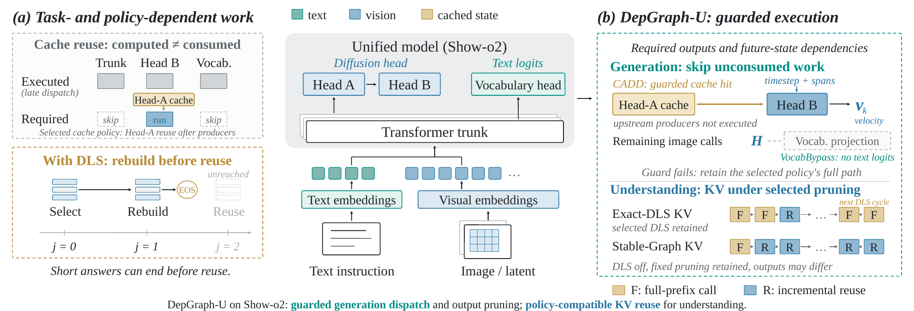

# DepGraph-U

**Dependency-Aware Execution Pruning for Unified Multimodal Inference**

Wentai Li · Jia-Bin Huang

[Paper](paper/DepGraph_U.pdf) · [Reproduction](docs/reproduction.md) · [Results](docs/results.md) · [Metric correction](docs/errata.md) · [Code map](docs/code-map.md)

DepGraph-U studies computation that still executes after its outputs have become unnecessary. It moves cache-dependent dispatch before unused producers, omits unconsumed vocabulary projections, and aligns KV reuse with the active execution graph.

<p align="center"></p>

This is a **research artifact release**: implementation patches, model-specific adapters, recorded protocols, compact experimental evidence, and CPU verification tools. It is not a universal drop-in inference library. The portable GPU example has not yet been rerun on a clean GPU installation; historical results and release-time checks are distinguished below.

## Method

- **CADD:** check whether cached state supplies the image path before executing upstream producers. Preserve the current timestep, required transformations, and selected cache policy.
- **VocabBypass:** avoid a text vocabulary projection on image calls that do not consume text logits. Text generation and text-loss calls retain their projection.
- **Graph-compatible KV reuse:** Exact-DLS rebuilds compatible prefix states when dynamic layer selection changes the graph. Stable-Graph is a separate policy with different output/quality behavior.

The approximation policies are not claimed as new. We build on **Flash-Unified (FlashU)** for Show-o2 policies, **ML-Cache** for Lumina-DiMOO, and **TaylorSeer** for the OmniGen2 controls. The FlashU understanding reference is an explicit reconstruction, not an official released understanding implementation. [Baseline details →](docs/results.md)

## Results — with the denominator stated

| Comparison | Speedup | Output / quality scope |
|---|---:|---|
| Complete Show-o2 system vs. native Show-o2 | 2.88–3.21× | Approximation policies change generation quality |
| Show-o2 execution rewrites vs. the same fixed generation policy | 1.61–1.77× | Tested paired images match; not identity vs. native Show-o2 |
| Exact-DLS + last-position projection vs. reconstructed FlashU understanding | 1.15–2.34× | 24,769 / 24,769 decoded responses match |

**Cache compatibility is not sufficient:** 20,014 of 24,769 Exact-DLS examples (80.8%) terminate before an incremental reuse call. Rebuilding state, output length, and projection cost all affect realized latency.

### Transfer beyond Show-o2

| Model and fixed reference | Added change | GenEval | DPG-Bench |
|---|---|---:|---:|
| Lumina-DiMOO + ML-Cache | VocabBypass | 1.062× | 1.061× |
| OmniGen2 + TaylorSeer, last-layer-only control | CADD | 1.116× | 1.117× |

These are component gains against each named reference; paired outputs match in the recorded comparisons. OmniGen2 has a separate MLLM and DiT, so this is a component-transfer test rather than another shared-backbone UMM.

**BAGEL is a boundary case:** on a 12-prompt diagnostic GenEval subset, the isolated unused guidance-prefill rewrite gives approximately **1.0001×**, or **1.0013×** on the fixed FFN policy. The complete adapted system gives **1.107×**, mostly from inherited pruning. This subset is not a full GenEval result. BAGEL MMStar results and the scoring correction are documented separately.

## Start here — no GPU or external packages needed

```bash
git clone https://github.com/Arrebo1l/DepGraph-U.git
cd DepGraph-U
python3 scripts/verify_release.py
python3 scripts/summarize_results.py
python3 -m unittest discover -s tests -v
```

Use Python 3.10 or later. The verifier checks file hashes, latency ratios, response equality records, trace counts, and MMStar archived-answer rescoring. It **does not rerun inference**, rejudge generated images, or prove numerical equivalence for arbitrary inputs.

For source preparation and the optional OmniGen2 paired GPU example, see [reproduction.md](docs/reproduction.md). Model weights and benchmark datasets are obtained from upstream providers, not redistributed here.

## Repository layout

```text
assets/                 Overview image
configs/protocols/      Scientific settings, deployment identifiers removed
docs/                   Reproduction, results, code map, limitations, errata
environments/           Recorded environments and upstream dependency lists
examples/               Portable paired OmniGen2 GPU example
implementations/        Adapters and understanding reference code
paper/                  Original submitted PDF, preserved byte-for-byte
patches/                Changes against pinned upstream implementations
provenance/             Source hashes and publication transformations
reproducibility/        Compact evidence, checks, figure/table assets
results/                Summaries and selected per-example timings
scripts/                CPU audit, summary, source-preparation tools
tests/                  Release-tool and adapter guard tests
```

Historical names such as `TaskGraph`, `_tg_*`, `FlashU-R`, and old table numbers remain in archived code/evidence to preserve provenance. They are not additional methods. [File map →](docs/code-map.md)

## Release status

| Item | Status |
|---|---|
| Archived evidence and MMStar rescoring | Bundled; independently recomputable on CPU |
| Show-o2 generation / understanding patches | Pinned variants; application and target hashes checked locally |
| Lumina, OmniGen2, BAGEL adaptations | Recorded patches / adapters included |
| Portable GPU example | Source/CLI checked; clean GPU execution unverified |
| Consumer-GPU deployment, serving throughput, training | Not established by these experiments |

The PDF retains historical MMStar category-macro values. **Use the corrected overall accuracies in [the erratum](docs/errata.md) for MMStar comparisons.** Rescoring changes aggregation only, not outputs, timings, or the PDF file.

Measurements primarily use batch size one on A800 hardware. Timing scope, output equality, stable-policy changes, the DPG evaluator correction, and cross-process reproducibility limits are described in [limitations.md](docs/limitations.md). Checkpoints and complete original generated-image collections are not included in this compact release.

## Citation

```bibtex
@misc{li2026depgraphu,
  title  = {DepGraph-U: Dependency-Aware Execution Pruning for Unified Multimodal Inference},
  author = {Li, Wentai and Huang, Jia-Bin},
  year   = {2026},
  note   = {Research manuscript},
  url    = {https://github.com/Arrebo1l/DepGraph-U}
}
```

This repository does not assert conference acceptance or an award. See [CITATION.cff](CITATION.cff) for structured metadata.

## Acknowledgments

We acknowledge [FlashU](https://github.com/Rirayh/FlashU), [Show-o](https://github.com/showlab/Show-o), [Lumina-DiMOO](https://github.com/Alpha-VLLM/Lumina-DiMOO), [OmniGen2](https://github.com/VectorSpaceLab/OmniGen2), [BAGEL](https://github.com/ByteDance-Seed/Bagel), and the benchmark/evaluator authors. Please cite the underlying work as appropriate. Upstream models, code, datasets, and licenses remain separate; see [THIRD_PARTY.md](THIRD_PARTY.md).

For reproduction issues, include the commit, hardware, environment, exact command, and failed check. Exclude access tokens and private dataset files.
